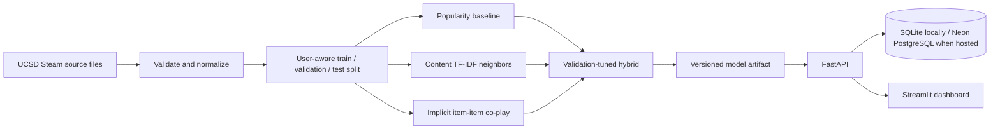

<div align="center">

# GameMatch 🎮

### Find your next game from the games you already enjoy.

Explainable Steam game recommendations, with offline and local API metrics.


[Problem](#the-problem) · [Results](#measured-results) · [Run locally](#run-locally) · [Architecture](#how-it-works) · [API](docs/api.md)

**Demo:** no hosted demo is live yet. Run the local Docker demo below.

</div>

## The problem

Steam's large catalog makes it hard for players to find something they will enjoy next. Popularity lists can keep showing already-visible games, while a player's existing library contains useful signals about their tastes.

GameMatch explores a practical discovery flow: players choose games they know, and the service ranks related titles using content similarity, co-play patterns, and popularity. Each recommendation includes an evidence-based explanation. The business problem is discovery friction; this project measures recommendation quality and service behavior, but does not claim proven gains in satisfaction, purchases, engagement, or retention.

## Measured results

| Measure | Result | Context |
| --- | ---: | --- |
| **Hybrid ranking quality** | **0.1389 NDCG@10** | 4,987 held-out users; 6,000 candidate games |
| **95% user-bootstrap interval** | **0.1310–0.1469** | Varies users within this one test split |
| **Collaborative baseline** | **0.1360 NDCG@10** | Hybrid is 0.0029 higher on this split; this does not establish a significant lift |
| **Local API throughput** | **57.0 requests/second** | One Docker run, concurrency 5 |
| **Local API response time** | **82.7 ms p50 · 128.5 ms p95** | 100 requests; 100 returned HTTP 200 |
| **Training + evaluation** | **570 seconds** | Sampled peak process memory: **1,412.9 MiB** |

The recommendation results use a historical Australian Steam sample and a random user-aware holdout because the library snapshot has no reliable timestamps. The API figures describe one local run; neither set of numbers predicts production capacity or business outcomes.

See the [evaluation report](reports/gamematch-v1/model_evaluation_report.md), [full metrics](reports/gamematch-v1/results.json), [interactive chart](reports/gamematch-v1/metrics.html), and [API load-test record](reports/gamematch-v1/load_test.json).

## What it does

- Compares **popularity**, **content-based**, **item-item collaborative**, and **hybrid** recommendations.
- Lets a player seed recommendations with games they select.
- Returns ranked titles, ranking scores, model version, fallback mode, and a concise explanation.
- Provides similar-game lookup, catalog search, persistent user picks, and operational metrics.
- Includes an offline evaluation dashboard and a REST API.

## Run locally

With Docker Desktop running:

```powershell
Copy-Item .env.example .env
docker compose up --build
```

Open the **Streamlit dashboard** at [http://localhost:8501](http://localhost:8501) and the **FastAPI docs** at [http://localhost:8000/docs](http://localhost:8000/docs). The API health endpoints are `/health` and `/ready`.

On first startup, the API downloads and prepares the source data, then trains the model in the background. Allow about **10 minutes** for this initial setup. `/ready` stays unavailable until the model and database are ready. Docker Compose starts PostgreSQL, FastAPI, and Streamlit; PostgreSQL data persists in a named volume. Set `GAMEMATCH_API_PORT` or `GAMEMATCH_DASHBOARD_PORT` in `.env` if those local ports are already in use.

### Python setup

Python 3.11+ is supported. For a direct API and dashboard run:

```powershell
py -3.13 -m venv .venv
.\.venv\Scripts\Activate.ps1
python -m pip install -r requirements-dev.txt
python -m pip install -e .
Copy-Item .env.example .env
```

Then start the API and dashboard in separate terminals:

```powershell
$env:GAMEMATCH_DATA_DIR = "./data"
uvicorn gamematch.api:app --reload
```

```powershell
$env:API_BASE_URL = "http://127.0.0.1:8000"
streamlit run dashboard/app.py
```

### Reproduce the evaluation

The raw source files and trained artifacts are kept outside Git. Download the dataset and train the model with:

```powershell
python -m scripts.download_data
python -m scripts.prepare_data
python -m scripts.train
```

The training command writes the inference artifact to `artifacts/models/gamematch-v1/model.joblib` and aggregate reports to `reports/gamematch-v1/`. Reports include baseline comparisons, confidence intervals, history-size slices, runtime, and sampled peak memory.

## How it works



Hybrid weights are selected on validation NDCG@10; the final test split is reserved for reporting. The configured validation weights are 0.7 collaborative, 0.2 content, and 0.1 popularity.

## API example

Search the catalog:

```powershell
Invoke-RestMethod "http://127.0.0.1:8000/v1/games?search=Portal"
```

Request recommendations from two selected games:

```powershell
$body = @{ positive_game_ids = @("620", "400"); n = 10 } | ConvertTo-Json
Invoke-RestMethod -Method Post `
  -Uri "http://127.0.0.1:8000/v1/recommendations" `
  -ContentType "application/json" `
  -Body $body
```

Scores are ranking signals, not probabilities. `PUT /v1/users/{user_id}/interactions` stores explicit picks under an HMAC-hashed profile key. Feedback is available for later analysis and does not retrain the model. See the [API reference](docs/api.md).

## Data and evaluation limits

The reproducible pipeline downloads three files from the official [UCSD/McAuley Steam dataset directory](https://mcauleylab.ucsd.edu/public_datasets/data/steam/) and links to the collection's [dataset page](https://cseweb.ucsd.edu/~jmcauley/datasets.html#steam_data). It uses the Version 1 Australian users/items and review samples plus Steam game metadata. The [dataset card](docs/data-card.md) lists the files, inspected fields, sizes, citation, terms, and caveats.

- A positive interaction means positive lifetime playtime, except when the same user explicitly reviewed the game with `recommend == false`.
- Zero-playtime ownership and unobserved games are **unknown**, not dislikes.
- The sample is old, regional, sparse, and not representative of today's Steam users.
- Random holdouts measure ranking on this snapshot, not future-time performance.
- Popularity and collaborative signals inherit historical exposure bias; game metadata is incomplete.
- The dataset page requests citation but does not state a formal reuse license. Do not redistribute its raw files. Raw files, per-user rows, and model artifacts are excluded from Git.

## Deployment and project status

There is **no public deployment URL yet**. Cloud provisioning is on hold. The repository includes a Render Blueprint and a [Render + Neon deployment runbook](docs/deployment.md); no Render or Neon resources have been created. See [deployment status](docs/deployment-status.md).

GitHub Actions runs Ruff, unit/API tests, Python compilation, and a Docker image build. The [GameMatch GitHub repository](https://github.com/chaitanya-maddala-236/GameMatch) is the source of truth.

## Further reading

- [Modeling and evaluation protocol](docs/modeling.md)
- [Architecture](docs/architecture.md)
- [Data card](docs/data-card.md)
- [Deployment runbook](docs/deployment.md)
