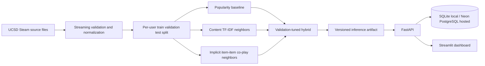

# GameMatch

GameMatch is an explainable video-game discovery service built from Steam interaction data. It compares popularity, content-based, item-item collaborative, and validation-tuned hybrid recommendations. FastAPI serves the catalog and rankings; a Streamlit dashboard shows recommendations, offline evaluation, and measured API activity.

The project reports offline ranking quality and real API operations separately. It does not claim to improve satisfaction, purchases, engagement, or retention.

## Architecture



## Data provenance and limits

The reproducible pipeline downloads three files from the official [UCSD/McAuley Steam dataset directory](https://mcauleylab.ucsd.edu/public_datasets/data/steam/) and links to the collection's [dataset page](https://cseweb.ucsd.edu/~jmcauley/datasets.html#steam_data). The selected files are the Version 1 Australian users/items and review samples plus the Steam game metadata file. See [the dataset card](docs/data-card.md) for exact files, inspected fields, sizes, citation, terms, and caveats.

The library snapshot has no interaction timestamps. A positive interaction is positive lifetime playtime, excluding a matching explicit `recommend == false` review. Zero-playtime ownership and unobserved games are unknown, not dislikes. We use deterministic random user-aware holdouts and tune hybrid weights on validation only. This is not a future-time evaluation. The sample is old, regional, and not representative of today's Steam population.

Raw files, per-user processed rows, and fitted model artifacts are excluded from Git. The dataset page requests citation but does not state a formal reuse license; do not redistribute its files. The app's code license is separate from the dataset's terms.

## Local setup

Python 3.11+ is supported. Dependencies are pinned in `requirements.txt` and `requirements-dev.txt`.

```powershell
py -3.13 -m venv .venv
.\.venv\Scripts\Activate.ps1
python -m pip install -r requirements-dev.txt
python -m pip install -e .
Copy-Item .env.example .env
```

Set `GAMEMATCH_DATA_DIR` to a writable data location. The project uses `./data` by default; raw and processed data are ignored by Git. Then reproduce the experiment:

```powershell
python -m scripts.download_data
python -m scripts.prepare_data
python -m scripts.train
```

The training command writes an inference artifact to `artifacts/models/gamematch-v1/model.joblib` and aggregate outputs to `reports/gamematch-v1/`. Results include the experiment configuration, all baseline comparisons, confidence interval, history-length slices, an interactive Plotly chart, runtime, and observed process peak memory.

## Start the services

```powershell
$env:GAMEMATCH_DATA_DIR = "./data"
uvicorn gamematch.api:app --reload
```

In another terminal:

```powershell
$env:API_BASE_URL = "http://127.0.0.1:8000"
streamlit run dashboard/app.py
```

The API is at `http://127.0.0.1:8000`; OpenAPI docs are at `/docs`. The dashboard defaults to `http://127.0.0.1:8501`. See [API reference](docs/api.md).

## API examples

```powershell
Invoke-RestMethod http://127.0.0.1:8000/v1/games?search=Portal
```

```powershell
$body = @{ positive_game_ids = @("620", "400"); n = 10 } | ConvertTo-Json
Invoke-RestMethod -Method Post -Uri http://127.0.0.1:8000/v1/recommendations -ContentType "application/json" -Body $body
```

Responses contain ranked titles, scores (ranking signals, not probabilities), model version, fallback mode, and an evidence-based explanation. `PUT /v1/users/{user_id}/interactions` persists explicit user picks with an HMAC-hashed profile key. Feedback is stored for later analysis and does not retrain the model.

## Metrics

- **Offline**: Precision@K, Recall@K, NDCG@K, MAP@K, catalog coverage, intra-list content diversity, novelty (self-information in bits), and top-decile popularity share. The exact definitions and candidate set are in the report.
- **Operational**: real request count, 5xx rate, p50/p95 handler latency, and feedback counts over the last 24 hours. Empty traffic has null latency rather than fabricated zero values.
- **Performance**: the training report records training-plus-evaluation duration and sampled peak RSS at a 100 ms interval. These local values are not a production load guarantee.

Latest offline evaluation: hybrid NDCG@10 **0.1389** on 4,987 held-out users (95% user-bootstrap interval **0.1310–0.1469**). A local Docker API run handled 100 concurrent-limited recommendation requests at 57.0 requests/second, with 82.7 ms p50 and 128.5 ms p95 latency. See the [evaluation report](reports/gamematch-v1/model_evaluation_report.md), [full metrics](reports/gamematch-v1/results.json), [chart](reports/gamematch-v1/metrics.html), and [load test record](reports/gamematch-v1/load_test.json). The API load result is one local run, not a capacity guarantee.

## Docker

With Docker Desktop running:

```powershell
Copy-Item .env.example .env
docker compose up --build
```

Compose starts PostgreSQL, the API, and dashboard. On first startup the API becomes live immediately and builds the model in the background into the bind-mounted data directory (`GAMEMATCH_HOST_DATA`, default `./data`). `/ready` remains 503 until the model and database are available. PostgreSQL uses the persistent `gamematch_postgres` volume. The dashboard waits for API readiness.

## CI and deployment

GitHub Actions runs Ruff, unit/API tests, Python compilation, and a Docker image build. The [Render Blueprint](render.yaml) provisions a 1 CPU / 2 GB API and a free dashboard; it uses Neon for PostgreSQL and a 5 GB persistent data disk. Current Render pricing estimates the API and disk at $26.25/month before tax or usage changes. Neon Free currently includes 100 compute-hours and 1 GB storage per project. The dashboard may sleep after inactivity, and the API must stay on a paid plan to fit the model's observed memory needs. The Blueprint does not create Neon resources or store its secret URL. Review the [deployment runbook](docs/deployment.md) before syncing the Blueprint.

Cloud provisioning is on hold at the user's direction. The local Compose stack has been smoke checked; see [deployment status](docs/deployment-status.md).

## Responsible-use limits

- Playtime is a weak preference proxy and does not establish enjoyment.
- Unobserved games are not negative labels.
- Historical popularity and collaborative signals inherit exposure bias.
- Sparse histories fall back to popularity; unseen games and metadata-poor games have limited support.
- Dataset age and regional sampling limit generalization.
- Offline results are not product outcomes. Feedback volume alone does not prove satisfaction.
- Profile identifiers are HMAC-hashed in persistent storage. Do not put real Steam account identifiers into a shared demo.

## Project files

- `docs/data-card.md` and generated `data/processed/data_dictionary.csv`
- `docs/modeling.md` and generated `model_evaluation_report.md`
- `docs/api.md`, `docs/architecture.md`, `docs/deployment.md`
- `PROJECT_PLAN.md`, `TASKS.md`, `DECISIONS.md`
